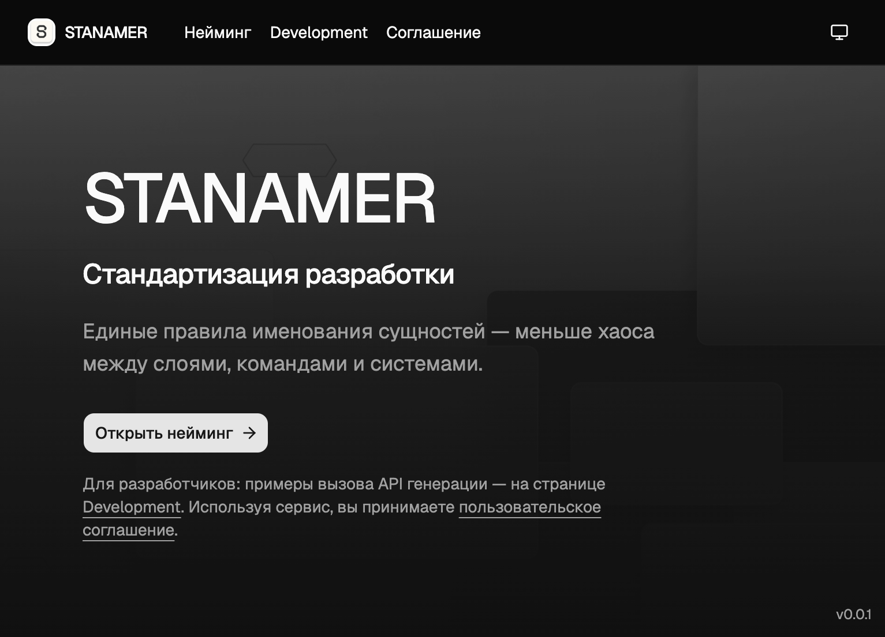
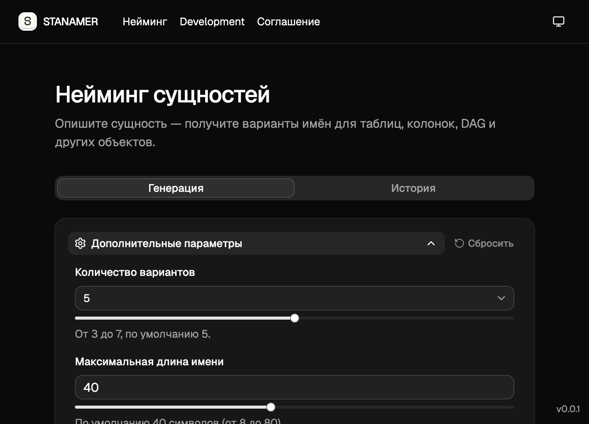
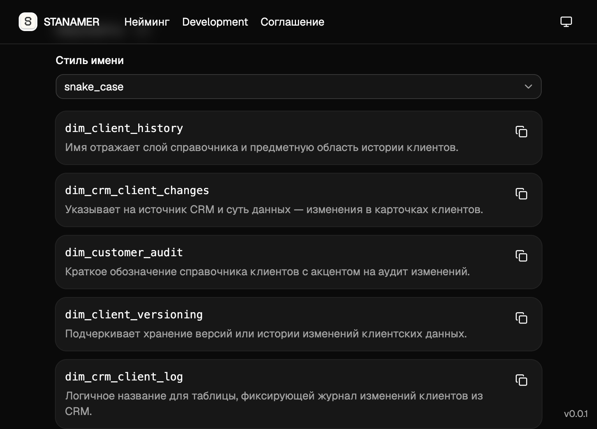
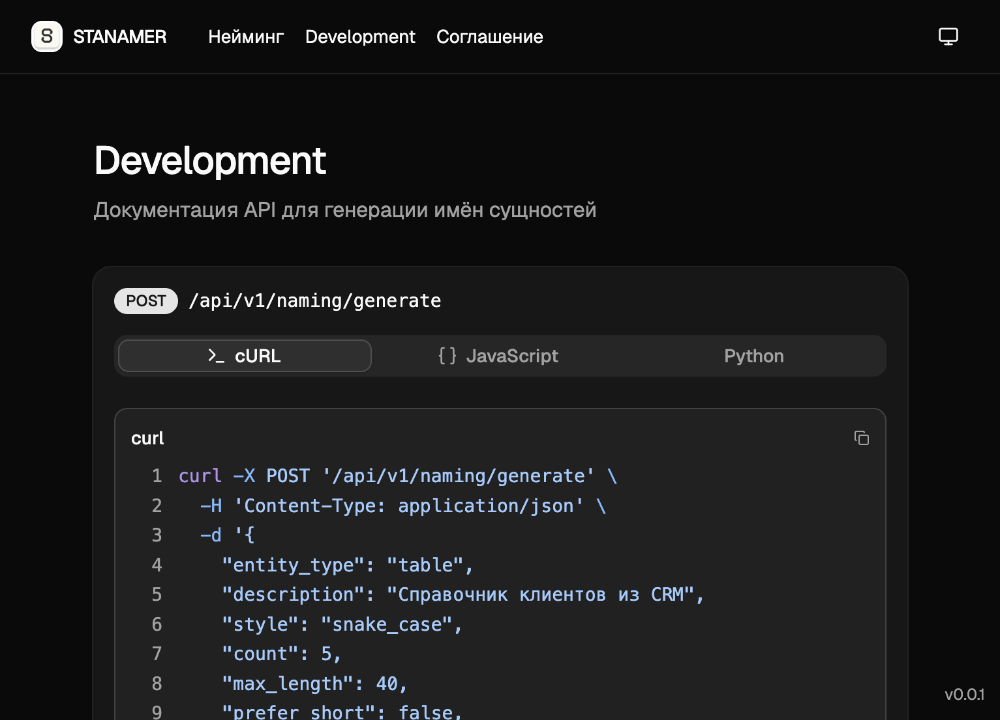

# STANAMER

<p align="center">
  
</p>

<p align="center">
  <strong>Стандартизация нейминга</strong> для таблиц, колонок, DAG, топиков и других сущностей
</p>

<p align="center">
  
  
  
  
  
  
</p>

<p align="center">
  
</p>

Опишите сущность — получите варианты имён с пояснениями, стилем (`snake_case` / `camelCase` / …), префиксом, постфиксом и опциональным контекстом. Есть UI, HTTP API и Swagger.

## Быстрый старт

```bash
cp .env.example .env   # OPENAI_BASE_URL, OPENAI_API_KEY, OPENAI_MODEL
docker compose up -d
```

Откройте **http://localhost:8080**

```bash
docker compose logs -f
docker compose down
```

## Скриншоты

| Нейминг | Параметры | Результат |
|:---:|:---:|:---:|
|  |  |  |

<p align="center">
  
</p>

## Возможности

- Генерация имён для `table`, `column`, `dag`, `topic`, `metric`, `schema`, `function`
- Доп. параметры: длина, количество, короткие имена, цифры, префикс / постфикс, контекст
- История в `localStorage`, тема light / dark / system
- API: `POST /api/v1/naming/generate` · UI-доки на `/dev` · Swagger на `/swagger`

## Стек

| Слой | Технологии |
|---|---|
| Frontend | React, Vite, shadcn/ui, Tailwind |
| Backend | FastAPI, OpenAI-compatible LLM |
| Runtime | Docker Compose, nginx → API |

## Конфиг (`.env`)

| Переменная | Назначение |
|---|---|
| `STANAMER_PORT` | Порт UI (по умолчанию `8080`) |
| `OPENAI_BASE_URL` | Base URL шлюза |
| `OPENAI_API_KEY` | Токен |
| `OPENAI_MODEL` | Модель |
| `OPENAI_VERIFY_SSL` | Проверка TLS (`true` / `false`) |
| `CORS_ORIGINS` | Origins через запятую |

## Лицензия

[GPL-3.0](LICENSE)
